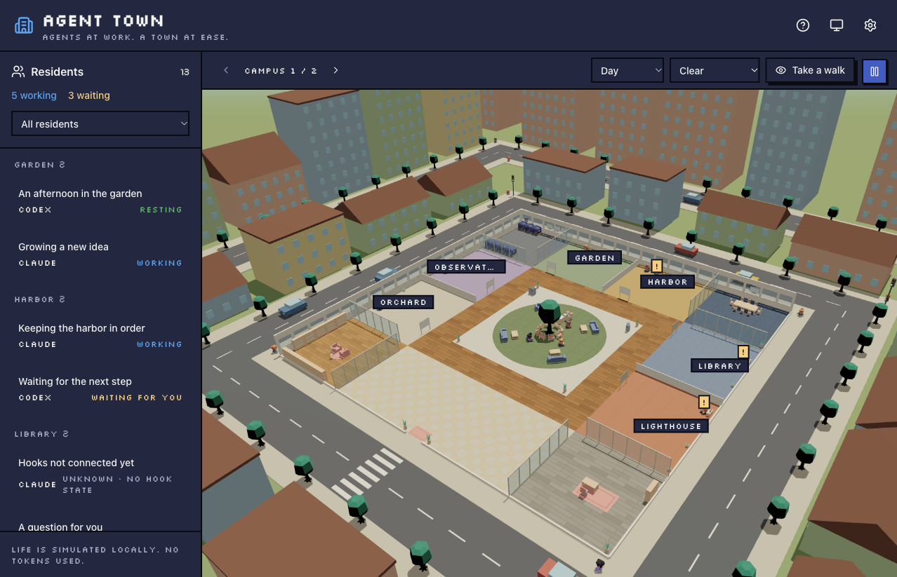

# Agent Town

[English](README.md) · [繁體中文](README.zh-TW.md) · [日本語](README.ja.md)

ローカルの Claude Code と Codex のセッションが暮らす、小さな 3D の街です。
住民は仕事をしたり、返事を待ったり、コーヒー休憩を取ったりします。生活アニメーションはローカルで動作し、モデルのトークンを消費しません。



## 起動

[Bun](https://bun.com/) 1.4.4 以降が必要です。
実際のセッションは共有の [Agent Session Bridge](https://github.com/chesterXalan/agent-session-bridge) から取得します。
Bridge のビルドには macOS 14 以降と Swift 6（Xcode Command Line Tools）が必要です。デモモードは bridge なしで利用できます。

```sh
git clone --recurse-submodules https://github.com/chesterXalan/agent-town.git
cd agent-town
bun install --frozen-lockfile
bun run bridge:setup
bun run hooks:install
bun run start
```

フック設定後に CLI セッションを再起動し、更新されたフックの確認が表示された場合は許可してください。
セットアップで独立した helper をインストールします。サーバーの起動時にフック設定を変更することはありません。
同じ bridge を使う他のアプリとは、フックとセッション情報を共有します。

**http://localhost:2510** を開きます。右上の**設定**から言語、都市、画質、フレームレート、ズーム感度、デモモードを変更できます。
`/?demo=1` を開くと、bridge なしで街を見学できます。
英語・繁体字中国語・日本語に対応し、初期設定ではシステムの言語に従います。未対応の言語では英語を使用します。
住民、デスク、状態バッジをクリックすると、その住民をカメラが追従します。カードを閉じると全体表示に戻ります。
ドラッグで視点を回転、スクロールでズームできます。**街を散策**を選ぶと WASD で移動できます。
プロジェクトごとに地区が割り当てられ、住民が増えると区画やキャンパスが追加されます。
初期設定はバランス画質・30 FPS です。PC に合わせて省電力・高画質や 10–60 FPS を選べます。既存のフレームレート設定は維持されます。
外観ボタンでシステム設定・ライト・ダークを切り替えられます。
日照と天気はネットワークから推定した位置を使います。設定で都市を検索すると上書きできます。
シーンの時間帯・天気メニューから手動で変更することもできます。

ブラウザーの**アプリをインストール／Dock に追加**メニューを使うと、Agent Town を独立したウィンドウで開けます。
実際のセッションを表示するにはローカルサービスの起動が必要です。キャッシュ済みの街とデモはサービスが停止していても開けます。
更新がある場合は再読み込みボタンが表示されます。
設定やインストール済みアプリを引き継ぐため、同じホスト名とポートを使ってください。
`127.0.0.1` でも接続できますが、ブラウザーの保存領域は別になります。

## 開発

```sh
bun run dev    # API :2510, Vite :2511
bun run check  # tests, typecheck, production build
bun run bridge:test  # shared Swift core tests
```

`bun run test` は既存の Vitest テストを実行します。
サーバー、開発ツール、ビルドは Bun で動作し、Node.js は不要です。任意の `.mise.toml` で検証済みの Bun バージョンを固定できます。

`AGENT_TOWN_PORT` で API のポートを変更できます。
`AGENT_TOWN_HELPER` は `agent-session-bridge` の絶対パスを上書きします。
既定値は `~/Library/Application Support/AgentSessionBridge/bin/agent-session-bridge` です。
Bridge は `vendor/` 内の submodule でバージョンを固定し、セットアップ時に必要に応じて初期化します。
`bun run hooks:remove` はすべての利用アプリの共有フックを削除しますが、helper と記録は残します。
サーバーは loopback のみにバインドします。接続方式と機能の範囲は[アーキテクチャ文書（英語）](docs/architecture.md)を参照してください。

設定手順や動作を変更するときは、英語・繁体字中国語・日本語の README を同時に更新してください。
技術文書とコードコメントは英語で記述します。

## クレジットとライセンス

同僚 **leolu** の `sdd-dashboard` を基にしたプロジェクトです。
引き継いだシーン、アニメーション、デザインシステムのコードは[出典情報（英語）](docs/provenance.md)に記録しています。
原作者の許可を得て公開しています。Agent Town のコードは [MIT License](LICENSE) で配布し、
原作者 **leolu** と改作を行った **chesterXalan** のクレジットを保持しています。
Kenney のモデルは CC0 です。[素材のライセンス表記（英語）](web/public/office/LICENSE.md)を参照してください。
天気予測は [Open-Meteo](https://open-meteo.com/)、都市名は [GeoNames](https://www.geonames.org/) によるもので、CC BY 4.0 に基づきます。
Open-Meteo の無料 API は非商用利用向けです。日照は [SunCalc](https://github.com/mourner/suncalc)（BSD-2-Clause）でローカル計算します。
ネットワークによる位置推定は [IPWhois](https://ipwhois.io/) が提供します。
