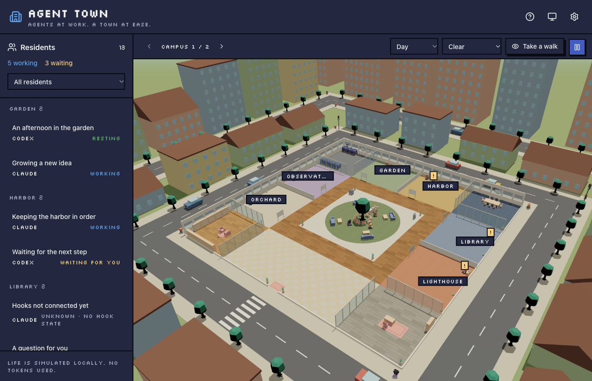

# Agent Town

A little 3D town for your local Claude Code and Codex sessions.
Residents work, wait for you, and take coffee breaks. Life animations run locally and use no model tokens.



## Run

Requires [Bun](https://bun.com/) 1.4.4 or later. The live bridge currently supports macOS with
[MH Desk Pets](https://github.com/chesterXalan/mh-desk-pets) installed and its hooks configured.
The desktop app does not need to be running.

```sh
bun install --frozen-lockfile
bun run start
```

Open **http://localhost:2510**. Use the top-right **Settings** gear for language, city, graphics quality, frame rate, zoom sensitivity, and demo mode,
or open `/?demo=1` to visit without a bridge. English, Traditional Chinese, and Japanese follow your system
by default, with English as the fallback.
Click a resident, their desk, or their status badge to follow them; close their card to return to the overview.
Drag to orbit, scroll to zoom, or choose **Take a walk** and use WASD.
Projects get their own districts; busy districts expand into additional wings and campuses.
Rendering defaults to Balanced quality at 30 FPS; choose Power saver or High quality and 10–60 FPS to suit your computer.
Existing frame-rate preferences are preserved.
The appearance button cycles through system, light, and dark. Daylight and weather use an approximate network location;
search for a city in Settings to override it. The scene's time and weather menus also allow manual overrides.

Install Agent Town from your browser’s **Install app / Add to Dock** menu for a separate window.
Keep the local service running for live sessions; the cached town and demo can open without it.
Updates offer a reload button. Use the same host and port to retain your preferences and installed app;
`127.0.0.1` still works but has separate browser storage.

## Development

```sh
bun run dev    # API :2510, Vite :2511
bun run check  # tests, typecheck, production build
```

`bun run test` uses the existing Vitest suite. Bun runs the server, development tools, and build;
Node.js is not required. The optional `.mise.toml` pins the tested Bun version.

`AGENT_TOWN_PORT` changes the API port. `AGENT_TOWN_HELPER` overrides the absolute path to
`deskpets-hook` (default: `/Applications/DeskPets.app/Contents/MacOS/deskpets-hook`).
The server always binds to loopback. See [Architecture](docs/architecture.md) for the adapter and scope.

## Credits and licensing

Adapted from our colleague **leolu**'s `sdd-dashboard`.
The retained scene, animation, and design-system code is recorded in [Provenance](docs/provenance.md).
Published with the original author's permission. Agent Town's code is distributed under the [MIT License](LICENSE),
with attribution to **leolu** for the original project and **chesterXalan** for this adaptation.
Kenney models are CC0; see the [asset notice](web/public/office/LICENSE.md).
Weather estimates come from [Open-Meteo](https://open-meteo.com/) and city names from [GeoNames](https://www.geonames.org/),
under CC BY 4.0. The Open-Meteo free API is for non-commercial use. Daylight is calculated locally with
[SunCalc](https://github.com/mourner/suncalc) (BSD-2-Clause).
Approximate network location is provided by [IPWhois](https://ipwhois.io/).
