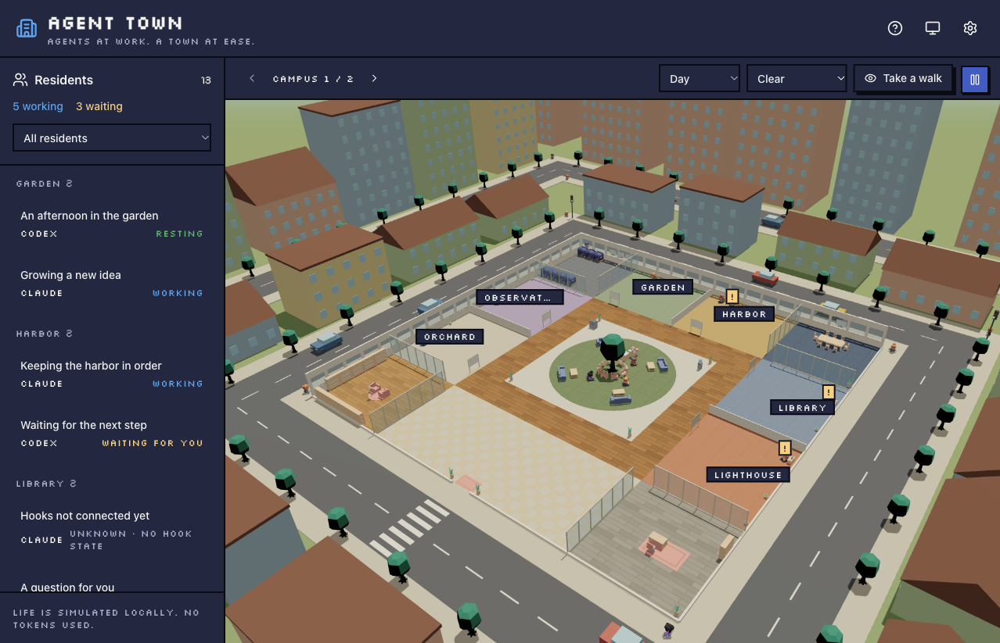

# Agent Town

[English](README.md) · [繁體中文](README.zh-TW.md) · [日本語](README.ja.md)

讓本機 Claude Code 與 Codex 工作階段住進一座 3D 小鎮
居民會工作、等你回覆，也會休息喝咖啡；生活動畫在本機運算，不消耗模型 tokens



## 執行

需要 [Bun](https://bun.com/) 1.4.4 以上版本
即時工作階段透過共用的 [Agent Session Bridge](https://github.com/chesterXalan/agent-session-bridge) 取得，
需要 macOS 14+ 與 Swift 6（Xcode Command Line Tools）來建置；示範模式不需要 bridge

```sh
git clone --recurse-submodules https://github.com/chesterXalan/agent-town.git
cd agent-town
bun install --frozen-lockfile
bun run bridge:setup
bun run hooks:install
bun run start
```

安裝 hooks 後請重開 CLI 工作階段，若出現更新後的 hooks 確認提示，請允許
設定步驟會安裝獨立的 helper；啟動伺服器不會修改 hooks 設定
其他使用相同 bridge 的應用程式會共用 hooks 與工作階段資訊

開啟 **http://localhost:2510** 後，可從右上角的 **設定** 齒輪調整語言、城市、畫質、畫面幀率、縮放靈敏度與示範模式，
也可以直接開啟 `/?demo=1`，不接 bridge 先逛逛
介面支援英文、繁體中文與日文，預設跟隨系統；不支援的語言會使用英文
點擊居民、辦公桌或狀態標記即可跟隨居民，關閉資料卡則回到總覽
拖曳可旋轉視角、滾動可縮放；選擇 **進去走走** 後，使用 WASD 移動
各專案有自己的分區，居民增加時會擴展成更多區塊與園區
預設使用平衡畫質與 30 FPS，也可依電腦效能選擇省電或高畫質，以及 10–60 FPS；既有的幀率設定會保留
外觀按鈕可在跟隨系統、亮色與暗色間切換
日照與天氣依網路推估的位置取得，可在設定中搜尋城市覆蓋；場景的時段與天氣選單也能手動調整

透過瀏覽器的**安裝應用程式／加入 Dock**選單，可將 Agent Town 開成獨立視窗
即時工作階段需要本機服務持續執行；已快取的小鎮與示範模式可在服務停止時開啟
有新版時會提供重新載入按鈕
請固定使用相同的主機名稱與連接埠，以保留偏好設定和已安裝的應用程式；`127.0.0.1` 也能使用，但瀏覽器儲存空間不同

## 開發

```sh
bun run dev    # API :2510, Vite :2511
bun run check  # tests, typecheck, production build
bun run bridge:test  # shared Swift core tests
```

`bun run test` 執行現有的 Vitest 測試
伺服器、開發工具與建置都使用 Bun，不需要 Node.js；選用的 `.mise.toml` 會鎖定已測試的 Bun 版本

`AGENT_TOWN_PORT` 可修改 API 連接埠
`AGENT_TOWN_HELPER` 可覆蓋 `agent-session-bridge` 的絕對路徑，
預設為 `~/Library/Application Support/AgentSessionBridge/bin/agent-session-bridge`
Bridge 透過 `vendor/` 下的 submodule 鎖定版本，設定時會在需要的情況下初始化
`bun run hooks:remove` 會移除所有使用此 bridge 的應用程式所共用的 hooks，保留 helper 與紀錄
伺服器只綁定本機 loopback；資料介接方式與功能範圍請見[架構文件（英文）](docs/architecture.md)

變更設定方式或行為時，請同步更新英文、繁體中文與日文 README
技術文件與程式註解維持英文

## 致謝與授權

改作自同事 **leolu** 的 `sdd-dashboard`
沿用的場景、動畫與設計系統程式碼記錄在[來源說明（英文）](docs/provenance.md)
已取得原作者同意公開；Agent Town 程式碼以 [MIT License](LICENSE) 發布，
保留原專案作者 **leolu** 與改作作者 **chesterXalan** 的署名
Kenney 模型採用 CC0，詳見[素材授權聲明（英文）](web/public/office/LICENSE.md)
天氣估計資料來自 [Open-Meteo](https://open-meteo.com/)，城市名稱來自 [GeoNames](https://www.geonames.org/)，採用 CC BY 4.0
Open-Meteo 的免費 API 限非商業使用；日照由 [SunCalc](https://github.com/mourner/suncalc) 在本機計算，採用 BSD-2-Clause
網路位置推估由 [IPWhois](https://ipwhois.io/) 提供
